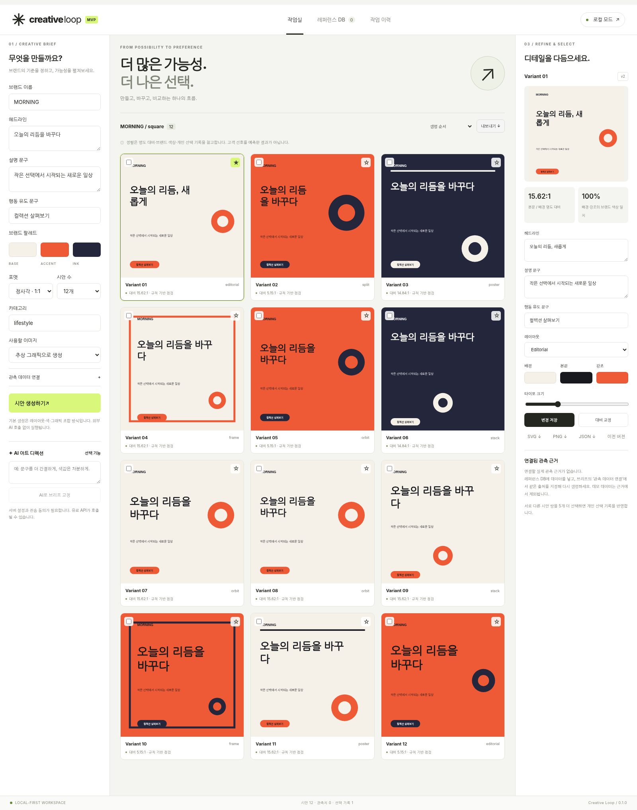

# Creative Loop

**만들고, 바꾸고, 비교하고, 선택하는 브랜드 크리에이티브 작업실.**

`v0.1.0` · Local-first · Korean UI · Python 3.13 · No API key required for the local workflow



## 이 프로젝트가 만드는 것

리서치 리포트나 가상 고객 인터뷰가 아니라 **실제 디자인 산출물**을 만드는 도구입니다. 브랜드 브리프를 입력해 여러 시안을 생성하고, 문구·색상·구성을 수정하고, A/B 비교로 고른 결과를 SVG·PNG·JSON으로 내보냅니다. 확보한 크리에이티브와 사용자 반응을 연결해 이후 제작의 근거를 남깁니다.

원대한 목표인 ‘최근의 모든 크리에이티브와 반응을 학습하는 생성 시스템’이 완성된 것은 아닙니다. 이번 릴리스는 **로컬 제작·편집·선택 흐름을 실제로 실행할 수 있는 첫 개발 마일스톤**입니다. 원격 GitHub 게시와 외부 AI 실호출 검증은 별도 단계입니다.

## 지금 되는 것과 안 되는 것

| 영역 | v0.1 구현 | 경계 |
|---|---|---|
| 크리에이티브 DB | PNG/JPG/WEBP 업로드, 사용권 기록, 댓글·공유 등 관측치 연결, JSON/CSV 가져오기 | SNS API 연결·전 세계 데이터 수집은 미구현 |
| 지속적인 반영 | 허가받은 로컬 내보내기 폴더의 신규·변경 파일 자동 가져오기 | 폴더 워처이며 SNS 크롤러가 아님 |
| 특징 추출 | 색상·크기·명도·색의 강도·경계 변화량을 픽셀에서 계산 | 기본 기능은 의미·정확한 폰트·객체 인식을 하지 않음 |
| 시안 생성 | 여섯 레이아웃, 세 가지 비율, 1~60개 재현 가능한 SVG 시안 | **레이아웃·색·모티프 조합**. 60개의 독립 AI 이미지 생성이 아님 |
| 교정·편집 | 문구·색·레이아웃·글자 크기, 대비 교정, 충돌 검사, 이전 버전 복원 | 자유로운 벡터 드로잉·드래그 레이어 편집기는 아님 |
| 비교·선택 | 최종 후보 표시, 같은 배치 A/B 선택, 선택 이유 저장 | 개인 디자이너의 선택이며 고객 조사 아님 |
| 근거 연결 | 같은 출처·카테고리·유입·관측 창에서 비교 가능한 실제 관측치 검색 | 유사 사례이지 새 시안의 예상 성과가 아님 |
| 정렬 | 대비·브랜드 색 규칙, 6쌍 이상 선택 시 개인 선택 모델 | 소비자 선호·CTR 예측 모델은 미구현 |
| 내보내기 | 개별 SVG·PNG·JSON, 후보/전체 ZIP | 폰트 미포함. Figma 전용 플러그인은 미구현 |
| AI 확장 | OpenAI 이미지 생성·이미지 수정, 브리프 교정, 이미지 의미 분석 어댑터 | **코드·모의 응답 계약 테스트 완료 / 실제 유료 호출 미검증** |

데모 반응 데이터는 `DEMO`로 표시하고 생성 참고·관측 근거에서 제외합니다. 외부 AI가 실패하면 가짜 성공 결과로 대체하지 않습니다.

## 5분 실행

Python **3.13**으로 검증했습니다. 먼저 이 폴더로 이동하세요.

```bash
python3 -m venv .venv
source .venv/bin/activate
python -m pip install -r requirements.txt
python -m uvicorn creative_loop.app:app --host 127.0.0.1 --port 8000
```

브라우저에서 `http://127.0.0.1:8000`을 엽니다. Windows는 가상환경 활성화 대신 `.venv\Scripts\Activate.ps1`을 사용합니다.

처음에는 API 키 없이 실행하세요. 생성 버튼 → 시안 선택 → 오른쪽 편집 → 두 시안 A/B 비교 → SVG/PNG/ZIP 내보내기 순서로 동작합니다. 기본 예시는 가상의 `MORNING` 브랜드이며 실제 특정 브랜드의 디자인을 복제한 자료가 아닙니다.

### 저장 위치

관측치, 작업 이력, 선택 기록은 `data/creative-loop.sqlite3`, 이미지는 `data/assets/`에 보관합니다. 서버를 끄고 다시 실행해도 남습니다. 공유 전 민감 데이터와 권한을 검토하세요. `data/`, `.env`, 로컬 내보내기 폴더는 Git에서 제외됩니다.

### Docker 대안

```bash
docker compose up --build
```

컨테이너 포트도 호스트의 `127.0.0.1`에만 공개합니다. Compose/Dockerfile은 제공하지만 이번 환경에서 Docker 빌드·실행은 검증하지 않았습니다. 공개 인터넷 서비스로 배포하는 설정이 아닙니다.

## 실제 AI 사용하기 — 명시적으로 활성화

```bash
cp .env.example .env
```

`.env`를 **자신의 컴퓨터에서** 편집합니다. 키를 채팅·브라우저 폼·GitHub에 붙여넣지 마세요.

```dotenv
ALLOW_EXTERNAL_AI=1
OPENAI_API_KEY=본인의_API_키
OPENAI_MODEL=계정에서_이용가능한_Responses_비전_구조화출력_모델
OPENAI_IMAGE_MODEL=계정에서_이용가능한_GPT_Image_계열_모델
MAX_PROVIDER_CALLS_PER_DAY=20
```

서버를 재시작하면 설정한 기능만 활성화됩니다. 모델 이름을 임의로 가정하거나 계정 사용 권한을 확인했다고 표시하지 않습니다. 상단 상태의 ‘설정 확인’은 API 접속 성공·모델 성능 검증을 뜻하지 않습니다.

**이미지 제작 흐름:** 레퍼런스 DB → AI 이미지 생성·수정 → 새 이미지 또는 업로드한 원본 선택 → 프롬프트 입력 → 외부 전송·유료 호출 동의 → 이미지 1장 생성 → 작업실에서 그 이미지를 포함한 최대 60개 레이아웃 탐색.

수정은 기존 이미지에 대한 **프롬프트 기반 전체 이미지 편집**입니다. 원본은 유지하고 결과를 새 이미지로 저장합니다. 브러시 마스크 UI·픽셀 단위 변경 보장·시드 기반 재현성은 제공하지 않습니다. 생성물에는 `AI 초안` 표시와 모델·프롬프트·원본 ID가 남습니다. AI 이미지의 글자나 로고가 정확하다고 가정하지 말고, 필요한 카피는 SVG의 편집 가능한 텍스트로 조합하세요.

**입력 권한:** 이미지 분석에는 `allow_model_input`, 수정에는 추가로 `allow_generation`이 필요합니다. 체크박스는 권한의 기록이지 법률적 검증이 아닙니다. 생성물은 외부 게시 전 내용·권리·브랜드 적합성을 검토해야 합니다.

호출 한도는 UTC 날짜 기준 **요청 횟수**이며 실패도 포함합니다. 금액 예산 제한이 아닙니다. 기본값은 하루 20회, 이미지 요청은 1회당 1장, 자동 재시도 없음입니다. 단일 프로세스/worker에서 사용하세요.

## 데이터 가져오기

레퍼런스 DB에서 `examples/demo-observations.json` 또는 `.csv`를 가져오면 형식을 확인할 수 있습니다. 예제 숫자는 합성 값이며 실제 사용자 반응이 아닙니다.

실데이터는 `docs/DATA_CONTRACT.md`를 따르세요. 출처 링크만 입력해도 자동으로 게시물·댓글을 수집하는 기능은 없습니다. 기본 가져오기는 이미지 파일과 관측치를 별도로 연결합니다. 노출수·좋아요 등 알 수 없는 값은 `null`/빈 칸으로 남기며 0으로 채우지 않습니다.

허가받은 시스템이 내보내기 파일을 갱신한다면 다음 워처로 반영할 수 있습니다.

```bash
mkdir -p imports
python scripts/watch_imports.py imports --once
# 계속 반영: 사용자가 실행 중인 이 프로세스가 60초마다 확인합니다.
python scripts/watch_imports.py imports --interval 60
```

파일 내용의 해시가 바뀌었을 때만 전송하고, 실패 파일은 성공 처리하지 않습니다. 동일한 출처 ID·관측 시점은 중복 삽입하지 않습니다. 최신 값은 **새 관측 시각**으로 보내세요. 워처를 실행한다고 API 사용권이나 SNS 접근 권한이 생기는 것은 아닙니다.

## GitHub로 게시

현재 ZIP은 **GitHub에 게시할 소스 패키지**입니다. 게시 스크립트가 로컬 Git 저장소와 초기 커밋을 준비합니다. 자동 실행할 수 있는 GitHub 저장소 생성 권한이 연결 도구에 없어, 원격 저장소를 생성하거나 기존 저장소를 수정하지 않았습니다.

Git과 GitHub CLI를 설치한 환경에서:

```bash
gh auth login
bash scripts/publish_github.sh
```

로그인한 계정에 **새 비공개 `creative-loop` 저장소**를 만들고 업로드합니다. `Jongtae` 계정으로 인증하면 대상은 `Jongtae/creative-loop`입니다. 이름이 이미 있거나 다른 원격 저장소가 연결돼 있으면 중단하며 덮어쓰지 않습니다. 다른 새 이름은 스크립트의 첫 인자로 지정할 수 있습니다.

필요한 후속 개발 이슈도 준비했습니다. 게시 후 다음 명령은 비공개 저장소에 아직 없는 백로그 이슈를 생성합니다.

```bash
python scripts/create_github_issues.py
```

GitHub Projects 보드는 자동 생성하지 않습니다. 기본 관리는 이슈와 `docs/BACKLOG.md`로 시작합니다. CI 워크플로는 포함했지만 원격 Actions에서 실행됐다는 뜻은 아닙니다.

## 검증

```bash
pip install -r requirements-dev.txt
python -m pytest -q
python -m playwright install chromium
python scripts/browser_smoke.py --transport network --artifacts artifacts
```

이번 검증 결과: **자동 테스트 69개 통과**, **Chromium 기반 작업 흐름 10개 통과**. 브라우저 검증은 환경 정책상 localhost 직접 탐색이 차단되어, 네트워크 접근 없이 실제 FastAPI TestClient에 연결하는 `--transport inprocess`로 수행했습니다. 실제 HTTP 전송 기반 브라우저 E2E, 유료 AI, SNS API, Docker, GitHub CI는 미검증입니다. 상세 조건은 `docs/VALIDATION.md`에 기록했습니다.

## 프로젝트 문서

- [요구사항과 MVP 기준](docs/PRD.md) · [구조와 알고리즘](docs/ARCHITECTURE.md)
- [데이터 계약](docs/DATA_CONTRACT.md) · [연구 원문 채택·보류 기록](docs/RESEARCH_ADOPTION.md)
- [테스트 결과와 남은 검증](docs/VALIDATION.md) · [개발 백로그](docs/BACKLOG.md)
- [공식 기술 문서](docs/SOURCES.md) · [개발 에이전트 지침](AGENTS.md) · [보안 경계](SECURITY.md)

**완료된 첫 단계:** 로컬에서 디자인을 생성·수정·비교·선택·내보내는 제작 흐름. **다음 핵심 단계:** 실제 AI 호출 파일럿, 사용권을 확보한 소셜 데이터 한 개 연결, 인간 선택·실제 반응으로 평가 모델의 유효성 검증.
